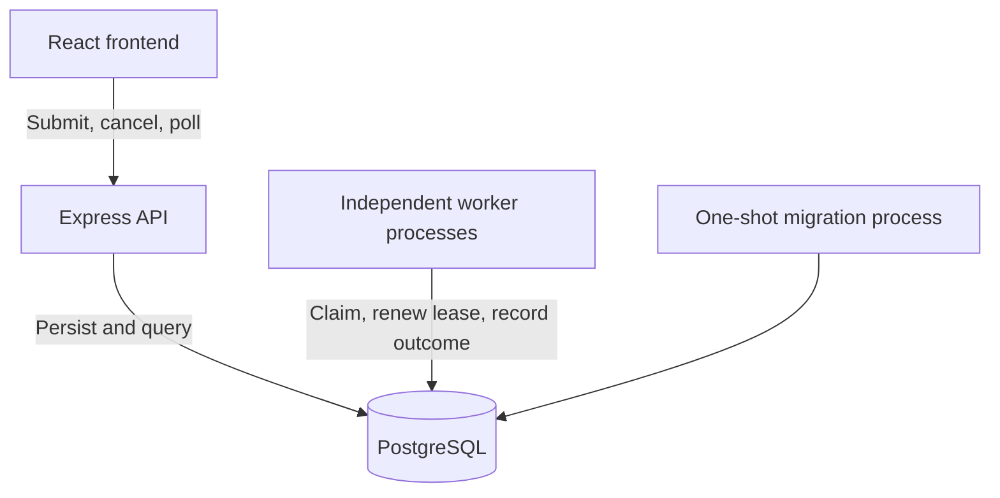
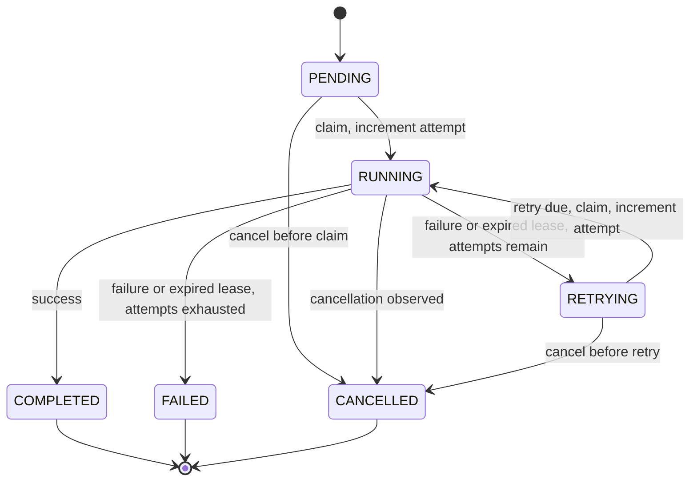

# Asynchronous job processing

Users submit jobs through an API and want to know when they finish. The jobs are long running, anywhere from seconds to minutes. Submissions arrive in unpredictable bursts. Some jobs fail and need retrying, users watch their status in real time, and now and then someone needs to cancel one that is already running.

This document describes a system for that: the architecture, what each component is responsible for, the three problems that turned out to be hardest, and the assumptions underneath it.

**The central decision is that PostgreSQL is the queue.** There is no broker, no Redis, and no shared in-memory state. Workers find work by querying a table and coordinate with each other through row locks and leases rather than through a coordinator process. The reasoning, and where that stops being a good trade, is in [Architecture](#architecture) and [What this design does not do](#what-this-design-does-not-do).

It is built and running rather than described on paper, because the claims worth making here are ones better measured than asserted: that two workers never resolve the same job, that a crashed worker loses nothing, that cancellation is responsive and has a knowable cost. Integration tests run against real PostgreSQL with multi-process worker fleets, and every performance number below is reproducible with `pnpm scaling` and `pnpm overhead`.

Jobs here are synthetic: a job occupies a worker for `durationMs`, then succeeds or fails deterministically. That keeps the exercise on the queueing, coordination, and recovery problems rather than on any particular workload.

To run it or watch a specific behavior, see **[DEMO.md](DEMO.md)**.

---

## Architecture

Using the database as the queue is the central bet of this design, so it is worth being explicit about why. A dedicated broker is the conventional answer and would scale further. But this system already needs a durable database: users query job status in real time, jobs must survive a crash mid-execution, and cancellation has to be decided against some authoritative record.

Once that database exists, adding a broker means two systems that can disagree about whether a job ran, and reconciling them is a harder problem than the one the broker solves. Using one store for both state and dispatch removes that entire class of bug. It trades peak throughput for an invariant that is much easier to reason about, and at the scale this exercise describes, that trade is favorable. Where it stops being favorable is [discussed below](#what-this-design-does-not-do).

Submission and execution are fully decoupled. `POST /jobs` validates, writes a row, and returns `201`. It never executes work and never waits for a worker, so a burst is absorbed as queue depth rather than as backpressure on the caller.

## Components

| Component | Responsibility |
| --- | --- |
| **API** (`apps/api`) | Validate requests, persist submissions, record cancellation intent, serve job and batch status. Never executes jobs. |
| **Worker** (`apps/worker`) | Claim one job at a time, execute it, record the outcome. Renews its lease while working, checks for cancellation during work, and recovers jobs abandoned by other workers. |
| **Web** (`apps/web`) | Submission controls and a polling dashboard. Shares contract types with the backend, never overlaps requests, retains last-known data when a poll fails, and stops polling data that is provably final. |
| **Contracts** (`packages/contracts`) | Zod schemas and shared types, with no server or database dependencies, so API, worker, and browser agree on one definition. |
| **Database** (`packages/database`) | Connection setup, migrations, and the explicit SQL shared by API and workers. Keeps the concurrency SQL in one readable place instead of duplicated across processes. |
| **PostgreSQL** | Durable state *and* coordination. The single source of truth for what ran, what is running, and who owns it. |

API and workers are separate processes sharing only the database. Workers scale by running more copies; nothing needs to know how many exist.

Three tables back this: `jobs`, `batches`, and `schema_migrations`. Database constraints encode the state machine directly, requiring a lease and a start time for `RUNNING`, a completion timestamp for terminal states, and `attempts <= max_attempts`. Those constraints are what make a logic bug fail loudly instead of silently corrupting a job.

### API surface

| Endpoint | Purpose | Success |
| --- | --- | --- |
| `POST /jobs` | Persist one queued job | `201` with `Location` |
| `GET /jobs` | Bounded page; `limit`, `offset`, `status` | `200` |
| `GET /jobs/:id` | Current job state | `200` |
| `POST /jobs/:id/cancel` | Cancel queued work, or record intent for running work | `200` resolved, `202` still running |
| `POST /batches` | Insert a batch and all its jobs in one transaction | `201` with `Location` |
| `GET /batches` | Bounded page of batches | `200` |
| `GET /batches/:id` | Status totals and derived run metrics | `200` |

Cancelling an already-terminal job returns its unchanged state, so the call is idempotent. An OpenAPI 3.1 document is served at `/openapi.json`, with Swagger UI at `/docs/`. [DEMO.md](DEMO.md#job-configuration) documents the job configuration fields and the schema.

## Job lifecycle

Terminal states are immutable. `cancelRequested` records intent while a job is still `RUNNING`; either the worker or expired-lease recovery resolves it. Attempts count claims, including attempts whose worker died.

**Retry policy.** Attempts are bounded by `maxAttempts`, which a submission sets between 1 and 10. A failed attempt with budget remaining moves to `RETRYING` and becomes claimable again after a fixed 250 ms delay; one with no budget left becomes `FAILED` and keeps its last error. A recovered attempt, where the worker died rather than the job failing, follows the same path, so a crash costs an attempt exactly as a failure does.

The fixed delay is an exercise simplification. Real retries want exponential backoff with jitter: a batch of jobs failing against the same unavailable dependency will otherwise retry in lockstep and hammer it on a fixed cadence. This is a different mechanism from the exponential backoff a worker uses when it cannot reach the database, which governs how often a worker polls, not when a job becomes eligible.

---

## The three hardest problems

### 1. Two workers can believe they own the same job; only one can write to it

This is the problem everything else depends on, and it is entirely a concurrency problem. Note the claim carefully: once a lease lapses and the job is reassigned, the original worker is still running and still believes the job is its own. Two workers genuinely hold that belief at the same time. What the design guarantees is narrower and more useful: only one of them can change the job's state.

Claiming is a short transaction: select one eligible row `FOR UPDATE SKIP LOCKED`, set status, attempt, and lease owner, commit. `SKIP LOCKED` is what makes concurrency work. A worker that finds a row already being claimed moves to the next eligible row instead of blocking behind the lock, so workers never queue up on each other.

The transaction commits *before* the job executes. Holding a transaction open across a multi-minute task would pin a connection, block vacuum, and turn one slow job into database-wide pressure.

That commit-then-execute split creates the real difficulty. Once the transaction closes, nothing at the database level stops a second worker from acting on the job if the first is presumed dead. So ownership is carried in the row itself. Every subsequent write (completion, failure, cancellation, lease renewal) is guarded on the job ID, the owner, the claimed attempt number, `RUNNING` status, and an unexpired lease evaluated in *database* time rather than worker clock time. A worker whose lease has lapsed and whose job has been reassigned cannot write to it: its update matches zero rows and it stops.

**What this costs.** Two things, both worth stating plainly.

First, ordering is best-effort rather than strict. The claim query orders by creation time, but `SKIP LOCKED` means a contended row is passed over rather than waited for, so under load a slightly newer job can start first. Buying strict FIFO back would mean workers blocking on each other, which is the behavior `SKIP LOCKED` exists to avoid.

Second, and more importantly: **this is at-least-once execution with bounded attempts, not exactly-once.** A worker can perform an effect and die before recording success. Lease expiry can overlap a dying attempt with its replacement. The guards protect database state; they cannot protect arbitrary external side effects. A real handler would need to be idempotent, and the honest version of this design says so rather than implying a guarantee it cannot make.

### 2. A worker can vanish, and the job has to survive it

A worker can crash, be killed, hang, or be partitioned from the database, and from the job's perspective these are indistinguishable. Rather than detect each case, the design collapses them into one: **a claim is a lease, and a lease expires.**

Workers renew every third of the lease duration while working. Before each poll, every worker also recovers up to 25 expired claims in a short `SKIP LOCKED` transaction: cancellation wins if requested, otherwise the job retries if attempts remain or fails if exhausted. Recovery is simply something workers do, so there is no separate recovery service to deploy and no single point whose failure stops recovery.

The same mechanism covers the case that is easiest to get wrong, which is a worker that is alive but cannot reach the database. It does attempt to record a failure for the job it was holding, and that write fails for the same reason everything else is failing. Nothing is lost by that. The attempt is simply abandoned: its lease lapses, and recovery resolves it once the database is reachable again and some worker reaches its recovery pass. The worker itself logs, backs off exponentially, and keeps polling rather than exiting, so it rejoins the fleet when the database returns.

**What this costs.** Lease duration is the real tuning knob, and it is a genuine trade rather than a value to optimize. Short leases recover quickly but risk declaring a slow-but-healthy worker dead, which produces duplicate execution. Long leases are safer but strand jobs for longer after a crash. The default is 30 seconds, renewed every 10, which tolerates a 20-second pause in a healthy worker. Note that a lapsed lease is when a job becomes *eligible* for recovery, not when it is recovered: workers run their recovery pass between jobs, so if every worker is busy on a long job, recovery waits for one of them to finish. A lease plus the longest job still running is therefore the realistic figure when the fleet is healthy, not a bound. It assumes at least one worker survives to run a recovery pass, that the database is reachable, and that the backlog fits the 25 claims a pass handles. If every worker dies, nothing recovers until one restarts; if the database is unreachable, nothing recovers at all; and a larger backlog drains over several passes. A real bound would need a dedicated recovery path rather than piggybacking on whichever workers happen to be idle.

### 3. Cancellation races everything else

Cancellation is the only operation where a user and a worker act on the same job at the same moment, which makes it the richest source of races. There are three, and they need different answers.

**Cancelling work that has not started** is a guarded row update. `PENDING` and `RETRYING` go straight to `CANCELLED`, which races safely against a concurrent claim because both contend for the same row.

**Cancelling running work** cannot be immediate, because the worker is mid-task and nothing can reach into it. The API records intent and returns `202`. The worker checks for cancellation every 250 ms of work. That is the polling interval, not an observed latency: the query round trip and event-loop scheduling sit on top of it, and the request itself has to land first. This is why work runs in short slices rather than one long sleep: a single `sleep(durationMs)` would make a five-minute job uncancellable for five minutes. Responsiveness to cancellation is a property of how work is *structured*, not something that can be bolted on afterwards.

**Cancellation racing completion** is the subtle one. A user can cancel in the same instant a worker finishes. Both resolve against current database state in a single guarded statement rather than read-then-write: if intent is recorded first, the worker's finalization resolves to `CANCELLED`; if completion commits first, the terminal state stands. There is no window in which a cancelled job later reports success.

**What this costs, measured.** Slicing work for cancellation checks is not free, and the price is small and knowable. Each 250 ms slice costs about 3.4 ms of timer wakeup and one cancellation query. Because the slice count scales with job length, that is a **constant ~1.4% of runtime regardless of how long the job runs**. So the system pays roughly 1.4% of throughput to check for cancellation every 250 ms of work. A single long sleep would be free and would make a running job uncancellable for its entire duration.

Cancellation remains cooperative. It stops further work and marks the job; it cannot undo effects a real handler already performed.

---

## Notifying users

The brief asks for two different things: users query status in real time, *and* users are notified when a job completes or fails. Those are separate, and only the first is implemented.

**What exists.** Every status transition is durably persisted, so `GET /jobs/:id` always reflects current truth and the dashboard reflects it within a poll. That serves a user who is watching. It does nothing for a user who submitted a job and closed the tab, which is the case the notification requirement is really about.

**Proposed, not implemented.** The tempting approach, marking the job terminal and then sending the notification, is wrong: a crash between those two steps loses a notification with no record that it was owed. The fix is to make the notification as durable as the state change by writing it in the same transaction.

A terminal transition would insert a row into an `outbox` table inside the transaction that sets the terminal status. That write is atomic with the status change: if the job is terminal, the notification is owed; if the transaction rolls back, neither happened. A separate dispatcher then claims outbox rows with the same `FOR UPDATE SKIP LOCKED` pattern the workers already use, delivers a webhook or email, and marks the row sent. Delivery failures retry from the outbox rather than being lost.

Delivery is at-least-once for the same reason job execution is: the dispatcher can deliver and then die before recording it. So each event carries a stable ID that receivers use to deduplicate, which is the same contract the job system itself offers.

The appeal of this approach for this design specifically is that it needs no new infrastructure. The outbox is another table, and the dispatcher is another worker claiming from it exactly the way job workers already do.

---

## Absorbing bursts

The queue absorbs bursts by converting excess demand into depth and waiting time. `POST /batches` exists to make that observable: it inserts a batch and up to 1,000 jobs in one transaction using a bulk query rather than one HTTP request per job, and returns after persistence.

Batch metrics are derived from current job rows in a single query against a consistent snapshot. There are no stored counters, so nothing can drift from job state. Elapsed time runs from batch creation rather than from first execution, because queue wait is latency the user actually experiences. [DEMO.md](DEMO.md#batches-and-metrics) has the full definitions.

**What "high volume" is scoped to mean.** The brief gives no numerical target, so the claims here are bounded by what was actually measured, which is *worker execution* scaling. Peak API submission capacity was not measured: there is no load test against `POST /jobs`, and the burst path is exercised through batch insertion rather than through many concurrent HTTP requests.

**Measured scaling.** Draining the same 60-job batch with more workers gives 1.99x at two workers, 4.87x at five, and 9.67x at ten. Holding work per worker constant instead of total jobs, efficiency stays flat at 95-96% from one worker to ten while throughput rises from 1.9 to 18.9 jobs/s, so claim contention is not measurable at this scale.

The few percent short of perfect parallelism is fixed per-job overhead rather than coordination between workers: about 6 ms between jobs for the recovery pass, claim transaction, and completion write, plus roughly 6 ms fixed and 3.4 ms per cancellation slice inside each job. Database queries account for under a fifth of that; most is timer granularity and event-loop latency. Efficiency is therefore a function of job *duration* rather than of scale, at 94% for a 250 ms job and 98% for a two-second one. Reproducible with `pnpm scaling` and `pnpm overhead`; method and full tables in [DEMO.md](DEMO.md#scaling).

Absorbing a burst is not the same as having free capacity. Storage and submission capacity remain finite, and a sustained arrival rate above drain rate grows the queue without bound. Bounding it is admission control, which this system does not implement.

## Assumptions

- **Local, trusted-user exercise.** No authentication and no per-user ownership: any caller can read or cancel any job. A real deployment needs an owner column on `jobs` and an ownership predicate on every read and mutation. This is the largest gap between the exercise and the prompt, which describes users querying *their* jobs.
- **No admission control or rate limiting.** A single accepted batch can occupy workers for a long time; bounding aggregate queued work is not implemented.
- **Synthetic workloads.** Jobs consume time and fail on command. Real handlers would bring dependencies, variable resource use, and side effects cancellation cannot undo.
- **One active job per worker process.** Simplifies capacity and crash reasoning. Real workers would likely run several jobs concurrently.
- **PostgreSQL is a hard dependency** for submission, status, claiming, and lease renewal. Its availability is the system's availability.
- **Polling, not push.** Simple and adequate at this scale; it costs query load that grows with worker count and poll frequency. "Real time" here means job status and selected-batch metrics schedule their next poll 1 to 4 seconds after the previous one settles, plus request latency, and pause entirely while the tab is hidden. The batch list runs 2 to 8 seconds and the readiness check a flat 5. It is not a push channel and not sub-second.
- **Current state, not history.** Attempts and last error are durable; a full per-attempt audit trail is not.
- **Chaos controls are gated.** Chaos is deterministic fault injection: a job can be configured to fail on a chosen attempt, or to kill its worker after the work is done but before the outcome is recorded, so that retry and lease recovery can be demonstrated on demand rather than waited for. `crash_worker` is the one that can kill a process, so chaos is off by default and refused at admission rather than left open on a public write endpoint.

## What this design does not do

PostgreSQL-as-queue has a ceiling. Claim throughput is bounded by row-lock contention on the hot eligible-jobs index, and polling load grows with worker count. Measurements here reach ten workers and show no contention at that point, so a few dozen looks comfortable. Where the ceiling actually is has not been measured. The expectation is that at some scale, likely hundreds of workers, the claim query becomes the constraint and a dedicated broker starts to earn the second-system complexity it costs, but that is reasoning about the mechanism rather than a result.

Beyond that, a production version would want authentication and per-user ownership; admission control and rate limiting; autoscaling driven by queue depth and age; dead-letter handling for exhausted jobs; per-attempt history and retention; metrics and tracing; and a real availability plan for the database. Push-based status updates could replace polling if latency or query volume justified them.

None of these is required to make the design legible, which is why none is here.

---

**[DEMO.md](DEMO.md)**: running the system and reproducing each behavior.
